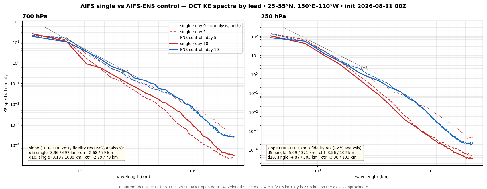
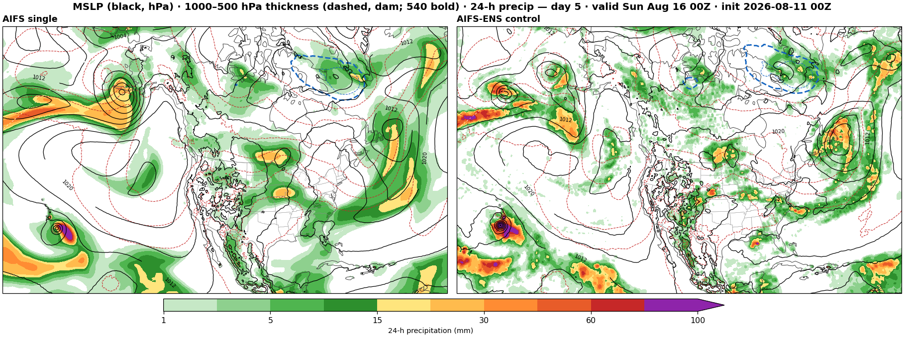

# Case study: AIFS single vs AIFS-ENS control — spectral fidelity by lead time

`quantmet.dct_spectra` applied to a question few have asked publicly: **does
ECMWF's deterministic AIFS blur faster than the AIFS-ENS control member?**
Both are 0.25° open-data products from the same 00Z analysis; one is trained
on an MSE-type objective, the other on an ensemble/CRPS-type objective.

DCT kinetic-energy spectra over a 25–55°N Pacific–North America box,
init 2026-08-11 00Z (dotted = analysis, identical for both by construction):

| lead | level | AIFS single | AIFS-ENS control |
|---|---|---|---|
| day 5 | 700 hPa | slope −3.96 · fidelity res 697 km | slope −2.68 · fidelity res 79 km |
| day 10 | 700 hPa | −3.13 · **1088 km** | −2.79 · 79 km |
| day 5 | 250 hPa | −5.09 · 371 km | −3.56 · 102 km |
| day 10 | 250 hPa | −4.87 · 503 km | −3.38 · 103 km |

**Corrected 2026-10-12 (quantmet 0.3.1).** The numbers first published here
came from `ke_spectrum` in quantmet ≤ 0.3.0, which labelled every spectral
bin one wavenumber too long (a 192 km mode was reported at 256 km, 96 km at
109.7 km) and dropped the longest bin. Rerun on the same open-data fields
with the fix, the slopes steepen and the fidelity resolutions shorten; the
0.3.0 values were, in the order of the table: −3.61 · 959 km / −2.35 · 82 km,
−2.95 · 1929 km / −2.52 · 82 km, −4.64 · 433 km / −3.29 · 106 km and
−4.44 · 626 km / −3.13 · 107 km. Rerunning the old code on the re-fetched
fields reproduces those exactly, so the change is the fix alone. The
conclusion stands: the single loses its small scales progressively, the
control does not.

**Grid caveat.** The box is a 0.25° latitude–longitude grid, but the
spectrum is computed with one grid spacing, `res_km` = 21.3 km (dx at 40°N).
dy is 27.8 km, and dx runs from 25.2 km at 25°N to 15.9 km at 55°N, so the
wavelength axis is approximate: the short (meridional) side of the box, 121
points, is 3336 km long but labelled 2577 km. Both models are binned
identically, so the comparison between them is unaffected; for exact
wavelengths, resample to a uniform projected grid first.

**Fidelity resolution** (`quantmet.dct_spectra.fidelity_resolution`): the
finest wavelength at which a forecast still carries ≥50% of its own
*analysis* spectral density. Unlike dissipation-range criteria it is defined
for any forecast, and it measures scale-dependent energy loss directly. A
fair objection — a day-10 spectrum may legitimately differ from day 0 because
the *weather* changed — answers itself here: both models rode the same
regime, and the control held the analysis spectrum to ~100 km throughout, so
the atmosphere's spectrum was quasi-stationary and the single's departure is
model smoothing, not meteorology.

The deterministic model slides toward an ensemble-mean-like state — MSE
rewards hedging, so unpredictable scales are averaged away, progressively and
apparently without bound. The CRPS-trained control keeps a quasi-stationary,
realistic spectrum ten days in: uncertainty lives in the ensemble spread, not
in per-member smoothness.

The same signature in physical space — MSLP / 1000–500 thickness / 24-h
precipitation at day 5, single (left) vs control (right); note the texture of
the precipitation fields:

A note on the reference slopes: the Nastrom–Gage canon puts k⁻³ at synoptic
scales and k⁻⁵/³ in the mesoscale, but **no 0.25° product resolves the
mesoscale transition** — the analysis slopes over 100–1000 km here are −3.2
(250 hPa) and −2.6 (700 hPa) (−2.9 and −2.3 before the 0.3.1 fix), and
everything below ~150 km is dissipation tail. The
−5/³ guide is drawn for orientation only.

Practical corollaries: past ~a week, read a single-AIFS chart as a smoothed
consensus rather than a weather realization; and any diagnostic quadratic in
the fields (E–P flux, wave-activity flux, eddy statistics) should be computed
from ensemble members, never from the blurred deterministic run. Whether the
control can simply *replace* the single for deterministic use — it arrives
only minutes later — is an open verification question this repo's owner is
now tracking operationally.

Reproduce: `python spectra_by_lead.py` (fetches ~15 MB of open data from ECMWF's
Google Cloud mirror into `./data`, prints the table and redraws the figure;
`aifs_spectra.npz` holds the spectra. Its `sh_*` arrays are spherical-harmonic
spectra carried over from the original run, not produced by this script and
unaffected by the fix).
